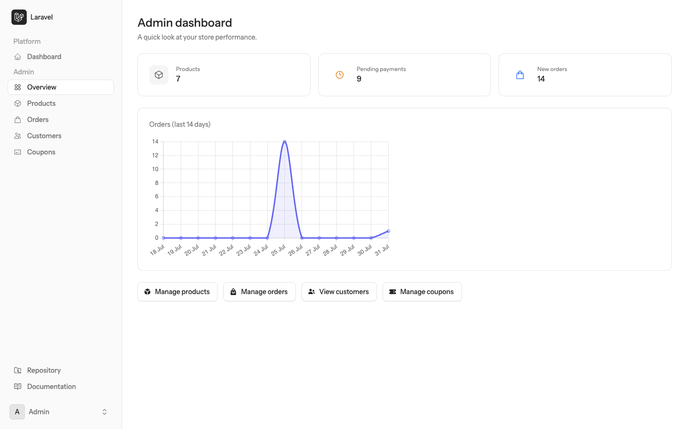
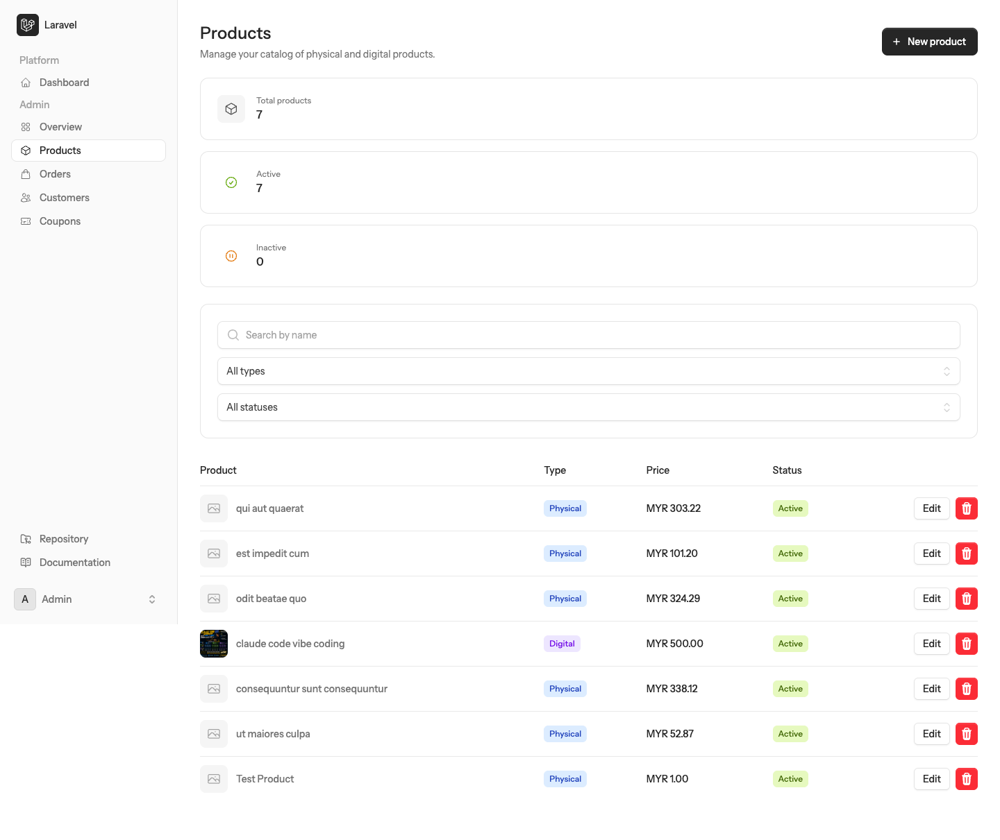
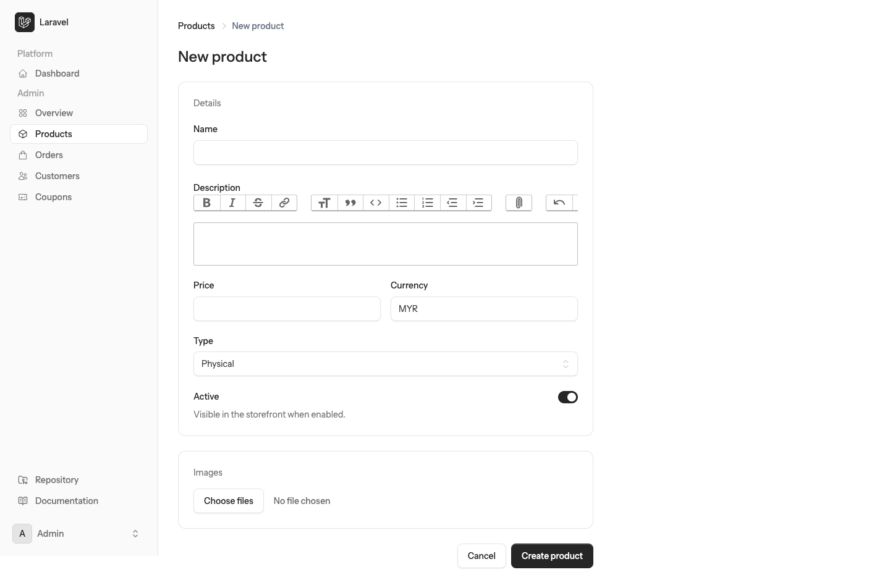
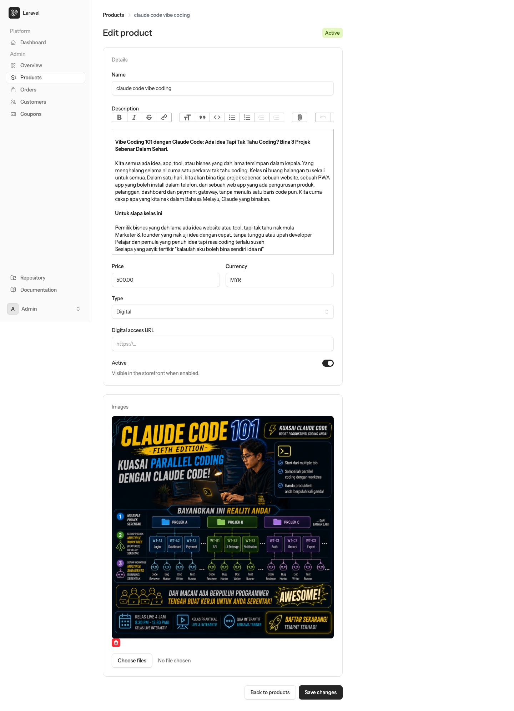
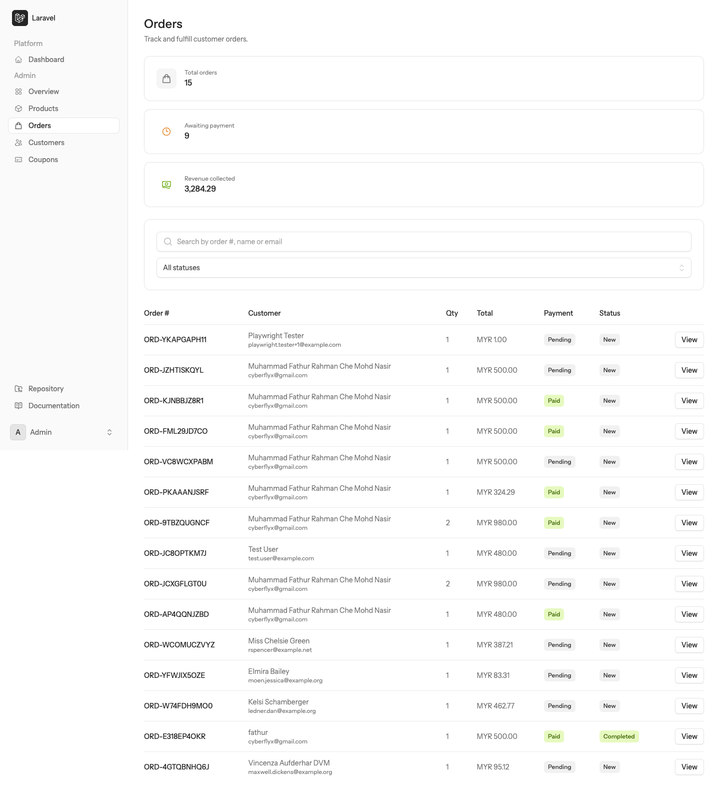
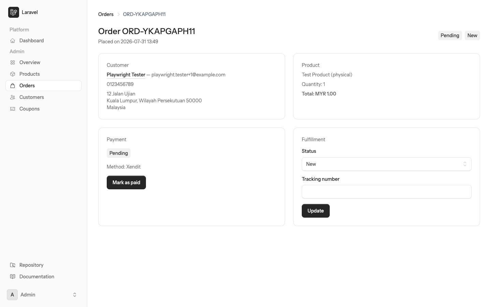
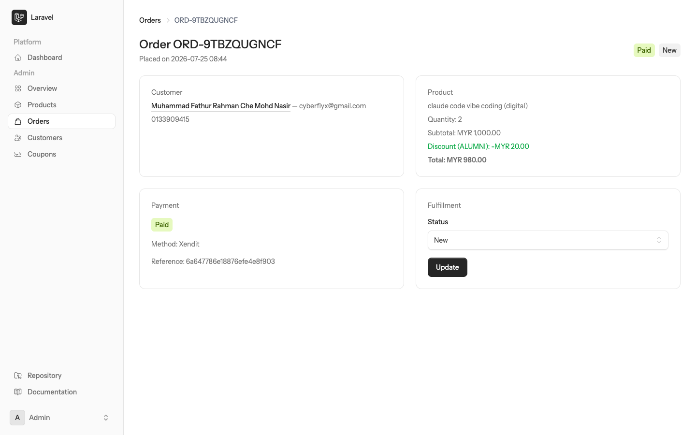

# Panduan Pengguna: Pengurusan Produk & Pesanan

Panduan ini menerangkan cara mengurus **produk** dan **pesanan** di dalam Panel Admin sistem LariPay.
Ia ditujukan kepada pengguna admin kedai yang bertanggungjawab menyenaraikan produk, memantau pembayaran dan menghantar pesanan kepada pelanggan.

---

## Kandungan

1. [Sebelum Bermula](#1-sebelum-bermula)
2. [Papan Pemuka Admin](#2-papan-pemuka-admin)
3. [Mengurus Produk](#3-mengurus-produk)
   - 3.1 [Melihat Senarai Produk](#31-melihat-senarai-produk)
   - 3.2 [Mencari & Menapis Produk](#32-mencari--menapis-produk)
   - 3.3 [Menambah Produk Baharu](#33-menambah-produk-baharu)
   - 3.4 [Produk Fizikal vs Produk Digital](#34-produk-fizikal-vs-produk-digital)
   - 3.5 [Mengemas Kini Produk](#35-mengemas-kini-produk)
   - 3.6 [Memadam Produk](#36-memadam-produk)
4. [Mengurus Pesanan](#4-mengurus-pesanan)
   - 4.1 [Melihat Senarai Pesanan](#41-melihat-senarai-pesanan)
   - 4.2 [Mencari & Menapis Pesanan](#42-mencari--menapis-pesanan)
   - 4.3 [Melihat Butiran Pesanan](#43-melihat-butiran-pesanan)
   - 4.4 [Menandakan Pesanan Sebagai Dibayar](#44-menandakan-pesanan-sebagai-dibayar)
   - 4.5 [Mengemas Kini Status Penghantaran](#45-mengemas-kini-status-penghantaran)
5. [Rujukan Status](#5-rujukan-status)
6. [Aliran Kerja Harian Yang Disyorkan](#6-aliran-kerja-harian-yang-disyorkan)
7. [Soalan Lazim](#7-soalan-lazim)

---

## 1. Sebelum Bermula

Sebelum anda boleh mengurus produk dan pesanan, pastikan:

- Anda mempunyai **akaun pengguna** dalam sistem.
- Akaun anda ditandakan sebagai **admin**. Hanya akaun admin boleh membuka menu di bawah bahagian *Admin*.
- Alamat e-mel anda telah **disahkan** (verified).

**Langkah log masuk:**

1. Buka pelayar web dan pergi ke halaman `/login`.
2. Masukkan **alamat e-mel** dan **kata laluan** anda, kemudian klik **Log in**.
   (Jika anda telah mendaftar *passkey*, anda boleh klik **Sign in with a passkey**.)
3. Selepas berjaya log masuk, klik **Overview** di bawah kumpulan menu **Admin** pada bar sisi kiri, atau terus pergi ke alamat `/admin`.

> **Nota:** Jika anda cuba membuka `/admin` tanpa kebenaran admin, sistem akan menyekat capaian anda.

---

## 2. Papan Pemuka Admin

Papan pemuka (`/admin`) memberikan gambaran ringkas prestasi kedai anda.

Elemen utama pada halaman ini:

| Elemen | Keterangan |
| --- | --- |
| **Products** | Jumlah keseluruhan produk dalam katalog. |
| **Pending payments** | Bilangan pesanan yang masih menunggu pembayaran. |
| **New orders** | Bilangan pesanan berstatus *New* yang belum diproses. |
| **Orders (last 14 days)** | Graf aliran pesanan bagi 14 hari terakhir. |
| **Butang pintasan** | *Manage products*, *Manage orders*, *View customers*, *Manage coupons*. |

Bar sisi kiri mengandungi menu utama: **Overview**, **Products**, **Orders**, **Customers** dan **Coupons**.

---

## 3. Mengurus Produk

### 3.1 Melihat Senarai Produk

Klik **Products** pada bar sisi (atau pergi ke `/admin/products`).

Di bahagian atas halaman terdapat tiga kad ringkasan:

- **Total products** – jumlah semua produk.
- **Active** – produk yang dipaparkan di kedai.
- **Inactive** – produk yang disembunyikan daripada kedai.

Jadual di bawahnya memaparkan lajur berikut:

| Lajur | Keterangan |
| --- | --- |
| **Product** | Gambar utama dan nama produk. |
| **Type** | Jenis produk — *Physical* atau *Digital*. |
| **Price** | Mata wang dan harga produk. |
| **Status** | *Active* (dipaparkan) atau *Inactive* (disembunyikan). |
| **Tindakan** | Butang **Edit** dan butang padam (ikon tong sampah). |

Senarai dipaparkan **10 produk setiap halaman**, disusun daripada yang terbaharu. Gunakan pautan halaman di bahagian bawah untuk melihat produk seterusnya.

### 3.2 Mencari & Menapis Produk

Kotak penapis di atas jadual membolehkan anda:

1. **Search by name** – taip sebahagian nama produk. Hasil ditapis secara automatik semasa anda menaip.
2. **All types** – tapis mengikut jenis: *Physical* atau *Digital*.
3. **All statuses** – tapis mengikut status: *Active* atau *Inactive*.

Apabila mana-mana penapis digunakan, butang **Clear filters** akan muncul untuk mengosongkan semula semua penapis.

> **Petua:** Penapis yang anda pilih disimpan dalam alamat URL, jadi anda boleh menyimpan (bookmark) atau berkongsi pautan senarai yang telah ditapis.

### 3.3 Menambah Produk Baharu

1. Pada halaman **Products**, klik butang **+ New product** di penjuru kanan atas.
2. Isikan borang **New product**.

Medan-medan yang perlu diisi:

| Medan | Wajib | Keterangan |
| --- | --- | --- |
| **Name** | Ya | Nama produk (maksimum 255 aksara). |
| **Description** | Tidak | Penerangan produk. Editor menyokong teks tebal, senget, senarai, pautan dan lampiran. |
| **Price** | Ya | Harga produk dalam nombor, contoh `500.00`. Tidak boleh negatif. |
| **Currency** | Ya | Kod mata wang 3 huruf, contoh `MYR`. |
| **Type** | Ya | *Physical* (barang fizikal) atau *Digital* (produk digital). |
| **Digital access URL** | Tidak | Hanya muncul untuk produk *Digital*. Pautan capaian yang diberikan kepada pembeli. Mesti bermula dengan `http://` atau `https://`. |
| **Active** | – | Suis hidup/mati. Bila dihidupkan, produk dipaparkan di kedai. |
| **Images** | Tidak | Maksimum **5 gambar**, saiz maksimum **2 MB** setiap satu, format imej sahaja. |

3. Klik **Create product** untuk menyimpan, atau **Cancel** untuk membatalkan.

> **Nota:** Medan **Digital access URL** hanya terpapar selepas jenis produk disimpan sebagai *Digital*. Jika anda menukar jenis semasa mencipta produk baharu, simpan dahulu produk tersebut, kemudian buka semula melalui **Edit** untuk mengisi pautan capaian digital.

### 3.4 Produk Fizikal vs Produk Digital

| Perkara | Produk Fizikal | Produk Digital |
| --- | --- | --- |
| Alamat penghantaran | Diperlukan daripada pelanggan | Tidak diperlukan |
| Nombor penjejakan | Ada pada halaman pesanan | Tiada |
| Pautan capaian | Tiada | Melalui medan *Digital access URL* / pautan muat turun |
| Proses penghantaran | Hantar melalui kurier, kemas kini status | Capaian diberikan selepas pembayaran disahkan |

### 3.5 Mengemas Kini Produk

1. Pada senarai produk, klik butang **Edit** pada baris produk berkenaan.
2. Halaman **Edit product** akan dipaparkan dengan maklumat sedia ada.

Perkara yang boleh dilakukan di halaman ini:

- Mengubah **nama, penerangan, harga, mata wang** dan **jenis** produk.
- Mengisi atau menukar **Digital access URL** (untuk produk digital).
- Menghidupkan atau mematikan suis **Active**. Mematikan suis ini menyembunyikan produk daripada kedai tanpa memadamnya.
- **Membuang gambar sedia ada** – klik ikon tong sampah merah pada gambar tersebut.
- **Menambah gambar baharu** – klik **Choose files** dan pilih gambar (had 5 gambar, 2 MB setiap satu).

3. Klik **Save changes** untuk menyimpan, atau **Back to products** untuk kembali tanpa menyimpan.

### 3.6 Memadam Produk

1. Pada senarai produk, klik butang merah **ikon tong sampah** pada baris produk.
2. Satu mesej pengesahan *"Delete this product?"* akan dipaparkan. Klik **OK** untuk teruskan.
3. Mesej *"Product deleted."* akan muncul apabila produk berjaya dipadam.

> **Amaran:** Pemadaman tidak boleh diundur melalui antara muka. Jika anda hanya mahu menyembunyikan produk daripada kedai buat sementara waktu, **matikan suis *Active*** dan bukannya memadamkannya. Ini memastikan rekod pesanan lama kekal kemas.

---

## 4. Mengurus Pesanan

### 4.1 Melihat Senarai Pesanan

Klik **Orders** pada bar sisi (atau pergi ke `/admin/orders`).

Tiga kad ringkasan di bahagian atas:

- **Total orders** – jumlah keseluruhan pesanan.
- **Awaiting payment** – bilangan pesanan yang pembayarannya masih *Pending*.
- **Revenue collected** – jumlah hasil daripada pesanan yang telah **dibayar** sahaja.

Lajur jadual pesanan:

| Lajur | Keterangan |
| --- | --- |
| **Order #** | Nombor rujukan pesanan, contoh `ORD-YKAPGAPH11`. |
| **Customer** | Nama dan e-mel pelanggan. |
| **Qty** | Kuantiti yang dibeli. |
| **Total** | Jumlah akhir yang perlu dibayar (selepas diskaun). |
| **Payment** | Status pembayaran: *Pending*, *Paid*, *Failed* atau *Refunded*. |
| **Status** | Status pemenuhan pesanan: *New*, *Processing*, *Shipped*, *Delivered*, *Completed* atau *Cancelled*. |
| **Tindakan** | Butang **View** untuk membuka butiran pesanan. |

Senarai dipaparkan **15 pesanan setiap halaman**, pesanan terbaharu di atas.

### 4.2 Mencari & Menapis Pesanan

- **Search by order #, name or email** – cari menggunakan nombor pesanan, nama pelanggan atau e-mel pelanggan.
- **All statuses** – tapis mengikut status pemenuhan pesanan.
- **Clear filters** – kosongkan semula semua penapis.

### 4.3 Melihat Butiran Pesanan

Klik butang **View** pada mana-mana baris pesanan.

Halaman butiran mengandungi empat kad:

**a) Customer**
Nama pelanggan (boleh diklik untuk melihat sejarah pembelian pelanggan tersebut), e-mel, nombor telefon dan alamat penghantaran (jika produk fizikal).

**b) Product**
Nama produk, jenis produk, kuantiti dan jumlah harga. Jika kupon digunakan, subtotal, kod kupon serta jumlah diskaun turut dipaparkan.

**c) Payment**
Status pembayaran, kaedah pembayaran (contoh *Xendit*) dan nombor rujukan pembayaran. Butang **Mark as paid** hanya muncul jika pesanan belum berstatus *Paid*.

**d) Fulfillment**
Pilihan **Status** dan medan **Tracking number** (untuk produk fizikal sahaja), berserta butang **Update**.

> Maklumat produk pada pesanan adalah **rekod salinan (snapshot)** pada masa pesanan dibuat. Menukar harga produk di katalog **tidak** akan mengubah pesanan lama.

### 4.4 Menandakan Pesanan Sebagai Dibayar

Gunakan langkah ini apabila anda menerima bayaran secara manual (contohnya pemindahan bank) atau apabila anda telah mengesahkan bayaran di luar sistem.

1. Buka butiran pesanan berkenaan.
2. Pada kad **Payment**, klik **Mark as paid**.
3. Mesej pengesahan *"Mark this order as paid?"* akan dipaparkan. Klik **OK**.
4. Status pembayaran bertukar kepada **Paid**, tarikh pembayaran direkodkan, dan nama admin yang mengesahkan turut disimpan sebagai rekod audit.

> **Peringatan:** Pesanan yang dibayar melalui gerbang pembayaran (Xendit) akan **bertukar kepada *Paid* secara automatik**. Gunakan **Mark as paid** hanya untuk pembayaran manual, kerana tindakan ini tidak boleh diundur melalui antara muka.

### 4.5 Mengemas Kini Status Penghantaran

1. Buka butiran pesanan.
2. Pada kad **Fulfillment**, pilih status baharu daripada senarai **Status**.
3. Untuk produk **fizikal**, isikan **Tracking number** (nombor penjejakan kurier) jika ada.
4. Klik **Update**. Mesej *"Order updated."* akan dipaparkan.

Apabila status ditukar kepada **Shipped** buat kali pertama, sistem merekodkan tarikh penghantaran secara automatik.

---

## 5. Rujukan Status

### Status Pembayaran (Payment)

| Status | Maksud | Tindakan disyorkan |
| --- | --- | --- |
| **Pending** | Menunggu pembayaran pelanggan. | Pantau; hubungi pelanggan jika terlalu lama. |
| **Paid** | Pembayaran telah diterima. | Teruskan proses penghantaran. |
| **Failed** | Pembayaran gagal. | Minta pelanggan cuba semula. |
| **Refunded** | Bayaran telah dipulangkan. | Tiada penghantaran diperlukan. |

### Status Pesanan (Fulfillment)

| Status | Maksud |
| --- | --- |
| **New** | Pesanan baharu, belum diproses. |
| **Processing** | Sedang disediakan atau dibungkus. |
| **Shipped** | Telah dihantar kepada kurier. |
| **Delivered** | Telah sampai kepada pelanggan. |
| **Completed** | Pesanan selesai sepenuhnya. |
| **Cancelled** | Pesanan dibatalkan. |

---

## 6. Aliran Kerja Harian Yang Disyorkan

1. Buka **Overview** untuk melihat bilangan *Pending payments* dan *New orders*.
2. Pergi ke **Orders**, tapis status **New**.
3. Bagi pesanan yang telah **Paid**:
   - Produk fizikal → sediakan bungkusan, tukar status kepada **Processing**.
   - Produk digital → pastikan pelanggan menerima pautan capaian.
4. Selepas bungkusan dihantar → masukkan **Tracking number**, tukar status kepada **Shipped**, klik **Update**.
5. Setelah pelanggan menerima barang → tukar status kepada **Delivered**, kemudian **Completed**.
6. Bagi pesanan yang lama berstatus **Pending**, hubungi pelanggan atau batalkan pesanan (**Cancelled**).

---

## 7. Soalan Lazim

**S: Saya tidak nampak menu *Admin* di bar sisi.**
J: Akaun anda bukan akaun admin. Hubungi pentadbir sistem untuk memberikan kebenaran admin kepada akaun anda.

**S: Kenapa produk saya tidak muncul di kedai?**
J: Semak dua perkara — pastikan suis **Active** dihidupkan pada halaman *Edit product*, dan pastikan produk telah disimpan.

**S: Berapa banyak gambar boleh dimuat naik bagi satu produk?**
J: Maksimum 5 gambar, dan setiap gambar tidak melebihi 2 MB.

**S: Medan *Digital access URL* tidak muncul.**
J: Medan ini hanya dipaparkan apabila jenis produk yang **telah disimpan** ialah *Digital*. Simpan produk sebagai *Digital* terlebih dahulu, kemudian buka semula melalui **Edit**.

**S: Bolehkah saya membatalkan tindakan *Mark as paid*?**
J: Tidak melalui antara muka admin. Sila pastikan pembayaran benar-benar diterima sebelum mengklik butang tersebut.

**S: Adakah pelanggan menerima e-mel?**
J: Ya. Apabila pesanan baharu dibuat, e-mel pengesahan dihantar kepada pelanggan dan pemberitahuan dihantar kepada semua admin.

**S: Kenapa harga pada pesanan lama berbeza dengan harga semasa produk?**
J: Setiap pesanan menyimpan salinan harga pada masa ia dibuat. Perubahan harga di katalog hanya memberi kesan kepada pesanan baharu.

---

*Dokumen ini dijana berdasarkan Panel Admin LariPay. Tangkapan skrin adalah daripada persekitaran pembangunan dan data yang dipaparkan hanyalah data contoh.*
